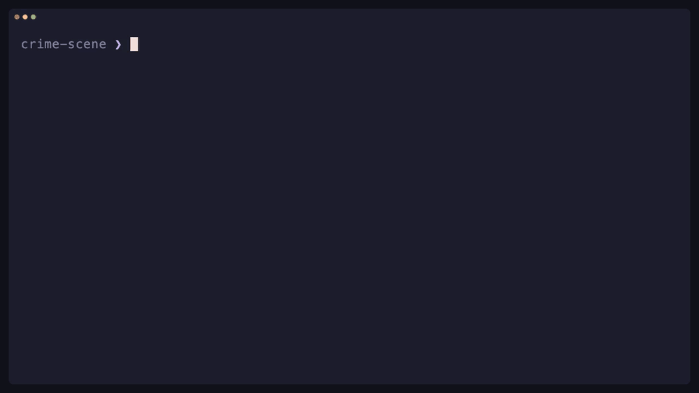

<h1 align="center">Pratfall</h1>

<p align="center">
  
</p>

<p align="center">
  <a href="https://github.com/nielsmadan/pratfall/actions/workflows/ci.yml"></a>
  <a href="https://codecov.io/gh/nielsmadan/pratfall"></a>
  <a href="https://github.com/nielsmadan/pratfall/releases/latest"></a>
  <a href="pyproject.toml"></a>
  <a href="LICENSE"></a>
</p>

One-shot coding agents for scripts and pipes.

Every agent CLI has a headless mode with its own flags, its own way of taking a prompt and its
own idea of what belongs on stdout. `prat` puts 24 of them behind one set of flags and one
output contract: the answer on stdout, diagnostics on stderr, and an optional JSON result with
status and usage. So agents compose like any other Unix tool.

<p align="center">
  
</p>

Pratfall runs the agent CLIs you already have installed and logged in. It installs nothing,
authenticates nothing, and leaves each agent's permission behavior as it is.

## Installation

Install with [Homebrew](https://brew.sh), then check which agent CLIs Pratfall finds:

```sh
brew install nielsmadan/tap/pratfall
prat doctor
```

Without Homebrew, install with [uv](https://docs.astral.sh/uv/) and Python 3.13+:

```sh
uv tool install git+https://github.com/nielsmadan/pratfall
```

You need at least one installed, authenticated agent CLI. See
[getting started](docs/user/getting-started.md) for pinning a release or running from a checkout.

Homebrew installs tab completion for bash and zsh. With uv, add
`eval "$(prat completion zsh)"` or `eval "$(prat completion bash)"` to your shell rc file; see
[shell completion](docs/user/getting-started.md#enable-shell-completion).

## Agents

Choose an agent by name or short alias:

| Agent | Name | Alias |
| --- | --- | --- |
| Claude Code | `claude` | `cc` |
| Codex | `codex` | `cx` |
| Gemini | `gemini` | `gm` |
| Copilot | `copilot` | `cp` |
| Cursor | `cursor` | `cu` |
| OpenCode | `opencode` | `oc` |
| Pi | `pi` | none |
| [17 more](docs/user/agents.md#selectors) | | |

Names of four letters or fewer, such as `kiro`, `qwen` and `amp`, need no alias. `prat agents`
lists all 24 with the settings each supports; [agents and limitations](docs/user/agents.md) has
the details.

## Same flags everywhere

Flags go before or after the selector:

```sh
prat cx --model gpt-5.6-luna --effort low "review this change"
prat cc --file request.md --timeout 120 --progress
printf 'summarize this checkout\n' | prat gm
```

| Parameter | Purpose |
| --- | --- |
| `--model MODEL` | Select a native model. |
| `--effort EFFORT` | Set reasoning effort. |
| `--fast` / `--no-fast` | Override fast mode for Claude or Codex. |
| `--timeout SECONDS` | Set the execution deadline; default: 600 seconds. |
| `--cwd PATH` | Choose the agent's working directory. |
| `-f PATH` / `--file PATH` | Read a prompt from a UTF-8 file; `-` reads stdin. |
| `-t NAME` / `--template NAME` | Apply a named prompt template. |
| `--param NAME=VALUE` | Fill a prompt parameter; repeat for several. |
| `-e` / `--edit` | Edit the complete prompt in `VISUAL`, `EDITOR`, or `vi`. |
| `--context PATH` | Prepend a context file; repeat to include several. |
| `-x` / `--extract` | Return the body of the first fenced code block. |
| `--schema PATH` | Request native JSON Schema output. |
| `--json` | Return one JSON result with output, status, and available usage. |
| `--attach PATH` | Attach a native image or file. |
| `--add-dir PATH` | Add a native workspace directory. |
| `--instructions TEXT` / `--instructions-file PATH` | Append native instructions. |
| `--tools NAME` / `--disable-tools NAME` | Restrict or disable native tools. |
| `--native-agent NAME` | Select a native agent or persona. |
| `--session-id ID` | Set the native session id. |
| `--progress` | Show live activity on stderr. |
| `--trace` | Copy captured native stdout to stderr. |
| `--notify` / `--no-notify` | Show or suppress the completion notification for this run. |
| `--dry-run` | Preview the resolved invocation without launching the agent. |

Budgets are available through `--max-budget-usd`, `--max-turns` and `--max-ai-credits` where the
agent supports them. Support for each setting varies by agent, and unsupported settings are
rejected rather than ignored. Native arguments go after `--`:

```sh
prat cx "inspect this change" -- --sandbox read-only
```

Tool filters restrict what an agent can call; they add no permission approvals and are not an
OS sandbox. [Running prompts](docs/user/running.md) covers every flag's rules and per-agent
limits, and [JSON output](docs/user/json.md) documents the result fields.
See [completion notifications](docs/user/running.md#get-a-completion-notification) for when it
fires and how to configure it.

## Composing prompts

A prompt comes from text, a file, or redirected stdin. When stdin is piped in alongside text or
`--file`, Prat combines them: stdin first, two newlines, then the explicit prompt. That is what
makes pipelines work:

```sh
prat cc "how many Rs are in strawberry" | prat cx "times 5"
prat cc -x "write a Python function that parses ISO dates" > parse.py
prat cc --schema answer.schema.json --json "summarize this project"
prat cc "review this" --context notes.md --context design.md
```

Use `--prompt=TEXT` for text starting with a dash. Save reusable prompts as templates, where
`$input` marks where piped input goes:

```toml
[templates.review]
prompt = "Review the following for bugs:\n\n$input"
```

```sh
git diff | prat cc -t review
prat templates
```

A template or profile `prompt` can also take named parameters, filled by position or `--param`:

```toml
[profiles.remove-empty]
agent = "cc"
prompt = "Delete empty files under $folder."
```

```sh
prat remove-empty src
```

See [templates](docs/user/running.md#apply-a-template),
[prompt parameters](docs/user/running.md#fill-prompt-parameters),
[context files](docs/user/running.md#include-context-files),
[editor prompts](docs/user/running.md#edit-the-prompt),
[code extraction](docs/user/running.md#extract-code) and [schema output](docs/user/running.md#request-schema-output).

## Workflows

A workflow is a named set of profile steps. Steps run in order, or in parallel when they do not
depend on each other, and an `after` list sends their outputs downstream:

```toml
[workflows.review-all]
steps = [
  { name = "scan", profile = "simple" },
  { name = "security", profile = "security-check", after = ["scan"] },
  { name = "style", profile = "style-check", after = ["scan"] },
  { name = "report", profile = "write-report", after = ["security", "style"] },
]
```

```sh
git diff | prat review-all
```

Each `profile` names a profile from your config. `security` and `style` run in parallel after
`scan`, and `report` receives both outputs. Run `prat workflows` to list them. See
[workflows](docs/user/workflows.md) for parameters, `bind`, failure behavior and JSON output. A
step can also run once per line or JSON element of an earlier step's output with
[`each`](docs/user/workflows.md#fan-out-over-items).

## Profiles

Save an agent and its settings under a name, then use that name like an alias:

```toml
version = 1

[profiles.simple]
agent = "codex"
model = "gpt-5.6-luna"
effort = "low"
```

```sh
prat simple "review this change"
prat simple --effort high "investigate this failure"
```

| Scope | Config file | Create an example |
| --- | --- | --- |
| Global | `~/.config/pratfall/config.toml`¹ | `prat config init` |
| Local | `.pratfile` in the invocation directory | `prat --config .pratfile config init` |

¹ Uses `$XDG_CONFIG_HOME/pratfall/config.toml` when `XDG_CONFIG_HOME` is set and nonempty.

Local configuration merges over global, and a local profile replaces a global one of the same
name. Settings resolve in this order: **command-line flags → profile → its `extends` chain → local
defaults → global defaults**. Use `extends` to share backend-specific settings through a base
profile:

```toml
[profiles.claude-base]
agent = "claude"
tools = ["Read", "Edit", "Bash"]

[profiles.weekly]
extends = "claude-base"
model   = "claude-opus-5"
```

`prat profiles` shows resolved profiles and `prat config validate` checks them. See
[profiles and configuration](docs/user/profiles.md) for defaults, command wrappers and merging
rules.

## More

- [User guides](docs/user/overview.md)
- [Contributing](CONTRIBUTING.md) and [developer documentation](docs/overview.md)
- [MIT license](LICENSE)
